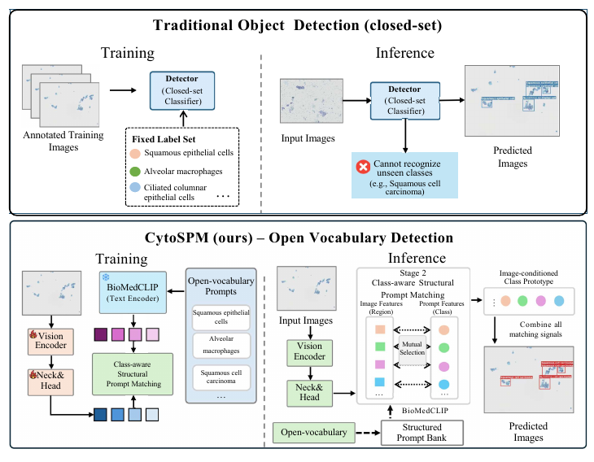
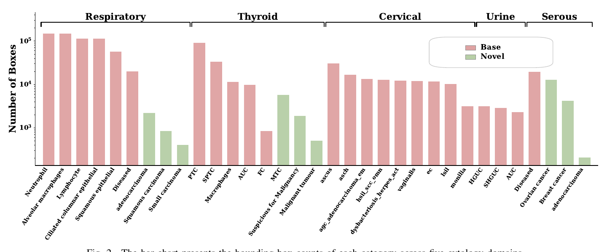
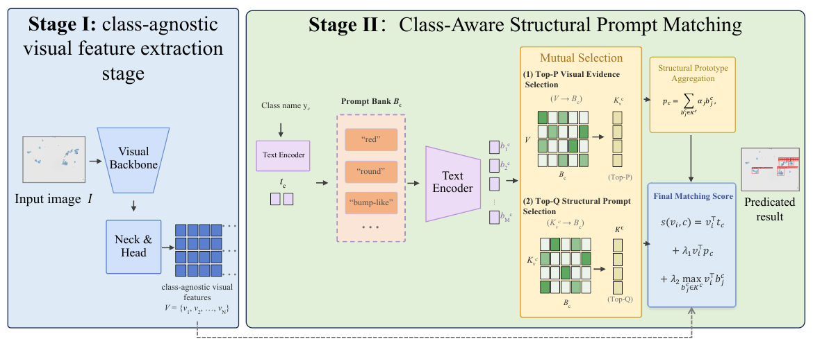
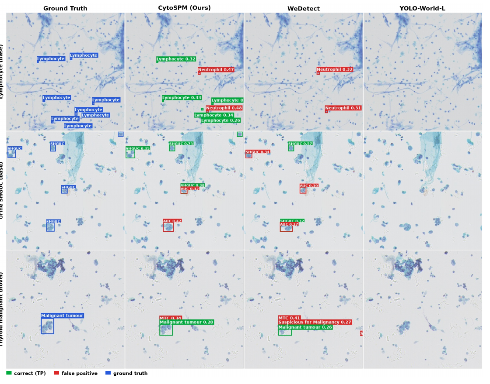

# CytoSPM: Open-Vocabulary Cytopathology Detection with Structured Prompt Bank

[](https://arxiv.org/abs/2609.31314)
[](LICENSE)

Official repository of **CytoSPM** and the **PentaCyto** benchmark (BIBM 2026).

> **CytoSPM: Open-Vocabulary Cytopathology Detection with Structured Prompt Bank**
> Wenjie Li\*, Zishan Xu\*, Jinyang Huang, Zhengxin Nie, Shichao Kan, Yixiong Liang†
> Central South University, Shanghai Jiao Tong University
> *IEEE International Conference on Bioinformatics and Biomedicine (BIBM), 2026*
> [[arXiv]](https://arxiv.org/abs/2609.31314)
>
> \* Equal contribution. † Corresponding author.

<p align="center">
  
</p>

## Abstract

Cytopathology detection requires open-vocabulary recognition because cellular categories are fine-grained, long-tailed, and continuously evolving across different organ systems. However, existing cytology detectors are mostly single-domain and closed-set, and there is still no unified benchmark for evaluating open-vocabulary cytopathology detection.

We present **PentaCyto**, a multi-domain benchmark covering cervical, urinary, respiratory, serous fluid, and thyroid cytology, with 24 base categories and 9 held-out novel categories. Each category is associated with structured cytomorphology prompts that describe diagnostic morphological attributes and provide clinically grounded textual knowledge.

We further propose **CytoSPM**, an efficient detector based on a decoupled two-stage design. It first extracts reusable class-agnostic visual representations, and then performs class-aware structural prompt matching with class names and cytomorphology prompts. On PentaCyto, CytoSPM outperforms existing methods in novel-category detection and open-vocabulary detection while maintaining efficient inference.

## News

- **2026-10**: Code, the structured prompt bank and pretrained weights ([Hugging Face](https://huggingface.co/Doilion111/CytoSPM)) are released.
- **2026-09**: Paper released on [arXiv](https://arxiv.org/abs/2609.31314).

The PentaCyto annotations may be released in the future.

## PentaCyto Benchmark

PentaCyto covers five cytology domains labelled according to their clinical reporting systems. See [`docs/pentacyto.md`](docs/pentacyto.md) for full statistics, category splits, and the evaluation protocol.

| Domain       | Standard | Base categories | Novel categories | Images (base / novel) | Boxes (base / novel) |
|--------------|----------|----------------:|-----------------:|----------------------:|---------------------:|
| Cervical     | TBS      | 9               | –                | 34,305 / –            | 123,474 / –          |
| Urinary      | Paris    | 3               | –                | 25,720 / –            | 8,410 / –            |
| Respiratory  | PSC      | 6               | 3                | 50,102 / 2,593        | 611,320 / 3,517      |
| Serous fluid | TIS      | 1               | 3                | 4,187 / 6,213         | 19,705 / 17,445      |
| Thyroid      | Bethesda | 5               | 3                | 40,719 / 2,656        | 149,172 / 8,250      |
| **Total**    |          | **24**          | **9**            | **155,033 / 11,462**  | **912,081 / 29,212** |

<p align="center">
  
</p>

## Method

CytoSPM is a decoupled two-stage framework:

1. **Stage I – Class-agnostic visual feature extraction.** A ConvNeXt-T backbone with neck and head produces region-level features using only the visual branch, with no class names, text prompts, or cross-modal fusion. These features are reusable across categories and prompt sets.
2. **Stage II – Class-aware structural prompt matching.** Class names and structured cytomorphology prompts are encoded by a frozen BioMedCLIP text encoder. A mutual-selection mechanism picks category-relevant visual regions (Top-P) and visually supported prompts (Top-Q), which are aggregated into an image-conditioned structural prototype. The final score combines class-name matching, structural prototype matching, and fine-grained attribute matching.

<p align="center">
  
</p>

## Main Results on PentaCyto

| Method          | Backbone      | #Params | FPS  | Base AP | Base AP50 | Base AP75 | Novel AP  | Novel AP50 | Novel AP75 | AP<sub>AVG</sub> |
|-----------------|---------------|--------:|-----:|--------:|----------:|----------:|----------:|-----------:|-----------:|-----------------:|
| GLIP            | Swin-T        | 231.8M  | 7.1  | 28.90   | 43.50     | 32.70     | 12.10     | 16.90      | 14.10      | 20.50            |
| Grounding DINO  | Swin-T        | 173.5M  | 6.2  | 30.40   | 47.50     | 33.80     | 2.80      | 4.30       | 3.30       | 16.60            |
| OV-DEIM         | DINOv3-ViT-T  | 11.4M   | 23.2 | 31.60   | 45.50     | 37.20     | 12.70     | 17.00      | 14.80      | 22.15            |
| YOLOE (text)    | YOLOv8-L      | 51.2M   | 75.3 | 33.60   | 48.30     | 39.10     | 6.40      | 8.80       | 7.40       | 20.00            |
| YOLOE (visual)  | YOLOv8-L      | 51.2M   | 75.3 | 29.70   | 43.10     | 34.30     | 12.50     | 16.90      | 14.90      | 21.10            |
| YOLOE (mixed)   | YOLOv8-L      | 51.2M   | 75.3 | 32.80   | 47.40     | 38.00     | 11.50     | 15.60      | 13.60      | 22.15            |
| YOLO-World-L    | YOLOv8-L      | 110.5M  | 25.7 | 32.40   | 48.20     | 37.50     | 13.70     | 18.30      | 15.80      | 23.05            |
| LLMDet          | Swin-T        | 173.0M  | 6.6  | 33.80   | 50.90     | 38.40     | 7.60      | 10.90      | 8.90       | 20.70            |
| MedROV          | YOLOv8-L      | 51.6M   | 52.2 | 27.96   | 39.25     | 32.66     | 3.62      | 4.76       | 4.03       | 15.79            |
| WeDetect        | ConvNeXt-T    | 37.9M   | 34.3 | 33.37   | 51.43     | 38.15     | 13.30     | 18.98      | 15.34      | 23.34            |
| **CytoSPM**     | ConvNeXt-T    | 37.9M   | 25.8 | 33.55   | **52.20** | 38.17     | **15.00** | **21.00**  | **17.20**  | **24.27**        |

<p align="center">
  
</p>

## Repository Structure

```
CytoSPM/
├── assets/                # figures
├── configs/cytospm.py     # model, data and schedule (ConvNeXt-T)
├── cytospm/               # model code (MMDetection 3.x modules)
├── data/
│   ├── PentaCyto/splits/  # base / novel category splits
│   ├── texts/             # class names, BioMedCLIP embeddings, organ masks
│   └── promptbank/        # structured cytomorphology prompt bank
├── docs/                  # benchmark documentation
├── tests/                 # CPU tests
└── tools/                 # training, evaluation and embedding scripts
```

## Installation

CytoSPM is tested with Python 3.10, CUDA 11.8, PyTorch 2.1.0 and MMCV 2.1.0.

```bash
conda create -n cytospm python=3.10 -y
conda activate cytospm
pip install torch==2.1.0 torchvision==0.16.0 --index-url https://download.pytorch.org/whl/cu118
pip install mmcv==2.1.0 -f https://download.openmmlab.com/mmcv/dist/cu118/torch2.1/index.html
pip install -r requirements.txt
```

Run all commands from the repository root.

## Data

CytoSPM reads COCO-format annotations. Each image must sit under a directory
named after its organ (`respiratory_tract`, `Serous_effusion`, `Thyroid_gland`,
`Urine` or `TCT_CCD`), because the organ is used to restrict the candidate
classes:

```
data/PentaCyto/
├── annotations/
│   ├── instances_train_dev_disjoint_dev30.json
│   ├── instances_val_dev_disjoint_dev30.json
│   ├── instances_test_base_clean_dev30.json
│   └── instances_test_novel_merged_9.json
└── images/
    ├── respiratory_tract/...
    ├── Serous_effusion/...
    ├── Thyroid_gland/...
    ├── Urine/...
    └── TCT_CCD/...
```

To use another location, set `CYTOSPM_DATA_ROOT=/path/to/dataset` or pass
`--data-root` to the evaluation scripts. Training and evaluation resize every
image to 640 x 640; `tools/cache_coco_640.py` can pre-compute this resize to
speed up data loading.

The class-name embeddings and the prompt bank are included in `data/texts` and
`data/promptbank`. To use CytoSPM on other categories, write class names and
structured prompts in the same JSON format and encode them with
`tools/build_text_embeddings.py` (see the README files in those folders).

## Model Weights

| Model | Backbone | Base AP | Base AP50 | Base AP75 | Novel AP | Novel AP50 | Novel AP75 | Download |
|-------|----------|--------:|----------:|----------:|---------:|-----------:|-----------:|----------|
| CytoSPM | ConvNeXt-T | 33.54 | 52.20 | 38.16 | 15.00 | 21.00 | 17.10 | [Hugging Face](https://huggingface.co/Doilion111/CytoSPM) |

This is the model reported in the paper (Table III). The numbers above were
measured with this repository on an RTX 3090, using images pre-resized by
`tools/cache_coco_640.py`. The paper values (33.55 / 52.20 / 38.17 and
15.00 / 21.00 / 17.20) were measured on an RTX 4090; the differences of at most
0.1 come from the GPU. Download the weight and check its SHA256
(`bc94215314319f712c731e8f5f24388df29d254cc2029695d32e815efb3aac4d`) with:

```bash
CKPT_FILES=cytospm_convnext_t.pth bash tools/fetch_checkpoints.sh
```

## Training

Training starts from the WeDetect-Tiny weights:

```bash
bash tools/fetch_checkpoints.sh                    # downloads checkpoints/wedetect_tiny.pth
bash tools/dist_train.sh configs/cytospm.py 2      # global batch 64 = 32 x 2 GPUs
```

With 32 images per GPU, training needs about 41 GB of memory per GPU (the paper
model was trained on two 48 GB GPUs). On 24 GB GPUs, use 4 GPUs with 16 images
each, which keeps the global batch of 64 and all other settings unchanged:

```bash
bash tools/dist_train.sh configs/cytospm.py 4 --cfg-options train_dataloader.batch_size=16
```

The schedule runs 12 epochs; the paper reports the epoch-9 checkpoint.

## Evaluation

Base categories: COCO AP over the 24 base categories, with the 6 negative
categories excluded (reported as `coco/all_class/mAP`; per-organ AP is printed
as well):

```bash
python tools/test.py configs/cytospm.py checkpoints/cytospm_convnext_t.pth
```

Novel categories (zero-shot): the detector weights stay fixed and only the
class-name embeddings, the prompt bank and the organ mask are replaced. The
defaults point to the PentaCyto novel split:

```bash
python tools/test_novel.py configs/cytospm.py checkpoints/cytospm_convnext_t.pth
```

Use `tools/dist_test.sh` for multi-GPU evaluation (set `SCRIPT=tools/test_novel.py`
for the novel split). To evaluate a checkpoint saved during your own training,
add `--allow-unsafe-checkpoint`; released weights are always loaded tensor-only.

## Ablations

The ablations in the paper only change settings of `configs/cytospm.py`; pass
them to `tools/train.py` or `tools/dist_train.sh` with `--cfg-options`:

| Setting | Override |
|---------|----------|
| Without the fine-grained attribute term | `model.bbox_head.head_module.prompt_matching.lambda2=0` |
| Without the structural prototype term | `model.bbox_head.head_module.prompt_matching.use_prototype=False` |
| Top-P / Top-Q | `model.bbox_head.head_module.prompt_matching.top_p=0.05 model.bbox_head.head_module.prompt_matching.top_q=0.5` |
| Without warm-up | `model.bbox_head.head_module.prompt_matching.warmup_iters=0` |

`top_p` and `top_q` values in (0, 1) are fractions (of the regions per feature
level and of each class's prompts); `top_q=0` keeps all prompts, which
corresponds to Q = 1 in the paper.

## Citation

If you find this work useful, please cite:

```bibtex
@inproceedings{li2026cytospm,
  title     = {CytoSPM: Open-Vocabulary Cytopathology Detection with Structured Prompt Bank},
  author    = {Li, Wenjie and Xu, Zishan and Huang, Jinyang and Nie, Zhengxin and Kan, Shichao and Liang, Yixiong},
  booktitle = {IEEE International Conference on Bioinformatics and Biomedicine (BIBM)},
  year      = {2026}
}

@article{li2026cytospm_arxiv,
  title   = {CytoSPM: Open-Vocabulary Cytopathology Detection with Structured Prompt Bank},
  author  = {Li, Wenjie and Xu, Zishan and Huang, Jinyang and Nie, Zhengxin and Kan, Shichao and Liang, Yixiong},
  journal = {arXiv preprint arXiv:2609.31314},
  year    = {2026}
}
```

## License

This project is released under the [GPL-3.0 License](LICENSE). It is a modified
derivative of WeDetect, YOLO-World and MMYOLO, which are GPL-3.0; see
[NOTICE](NOTICE) and [THIRD_PARTY_LICENSES.md](THIRD_PARTY_LICENSES.md).
CytoSPM is research software and not a validated clinical diagnostic device.

## Acknowledgements

CytoSPM builds upon [WeDetect](https://github.com/WeChatCV/WeDetect),
[YOLO-World](https://github.com/AILab-CVC/YOLO-World),
[MMYOLO](https://github.com/open-mmlab/mmyolo),
[MMDetection](https://github.com/open-mmlab/mmdetection) and
[BioMedCLIP](https://huggingface.co/microsoft/BiomedCLIP-PubMedBERT_256-vit_base_patch16_224).
We thank the authors for their open-source contributions.
